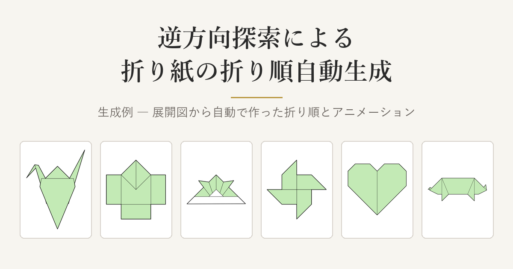

# 逆方向探索による折り紙の折り順自動生成 — 生成例

展開図から折り紙の折り順(折り図)を自動で生成した例を集めたページです。
作品ごとに**展開図**・**完成形**・**折り順**・**折りたたみアニメーション**を見られます。

**ページ: https://aotakataka.github.io/origami-demo/**



## 折り順の作り方

折り上がった形から**逆向きに1つずつ開いていき**、正方形1枚まで戻せた開き方の列を、逆の順に並べて折り順にしています。

1. 展開図を [ORIPA](https://github.com/oripa/oripa) で折り畳み、完成形(紙の重なり方を含む)を求める
2. 完成形から、開けそうな折り線を選んで開く。開けなければ別の折り線を試す(深さ優先探索)
3. 普通の山折り・谷折りのほかに、袋折り・花弁折り・中割り折り・かぶせ折りなども、形から見分けて1つの工程として開く
4. 正方形1枚まで戻せたら、開いた順の逆を折り順として、折り図とアニメーションを描く

折り順を作るプログラムは公開していません。

## 載せている作品

| 区分 | 作品 |
|---|---|
| 2D(平らに折り畳む作品) | 家・犬の顔・風車・カニ・兜・紙飛行機・セミ・だまし船・鶴・にわとり・ハート・花・ブタ・やっこさん |
| 3D(立体に起こす作品) | 鶴 |

## ページの見方

- **一覧**: 完成形のサムネイルが並んでいます。2D と 3D はタブで切り替えます
- **作品のページ**: 展開図・完成形(表と裏)・折り順の一覧・折りたたみアニメーションを載せています。3D の作品では、平らに畳んだあと立体に起こすアニメーションも見られます。アニメーションは一時停止・最初から再生・バーでの再生位置の移動ができます
- **工程のページ**(「工程を詳しく見る」): 1工程ずつ、絵・折り方の名前・指示文を並べています。「動きを見る」でその工程だけのアニメーションを再生します

スマホでは、折り順の一覧画像をタップすると原寸で開き、拡大して読めます。

### 図の見方

| 図 | 表し方 |
|---|---|
| 展開図 | 赤の線が山折り、青の線が谷折り |
| 折り順・アニメーション | 白が紙の表、緑が紙の裏。赤の破線がその工程で折る線 |

## ファイルの構成

```
index.html               ページ本体(作品の一覧もここに書いている)
2d/, 3d/
  crease_patterns/       展開図
  finished/              完成形(2D は表と裏)
  animations/            作品全体の折りたたみアニメーション
  steps/{作品}/           工程ごとの絵・アニメーション、折り順の一覧画像、工程の並び(steps.json)
og.png, favicon.*        共有したときの画像とアイコン
```

## 連絡先

aotaka@toki.waseda.jp

© 2026 aotakataka
